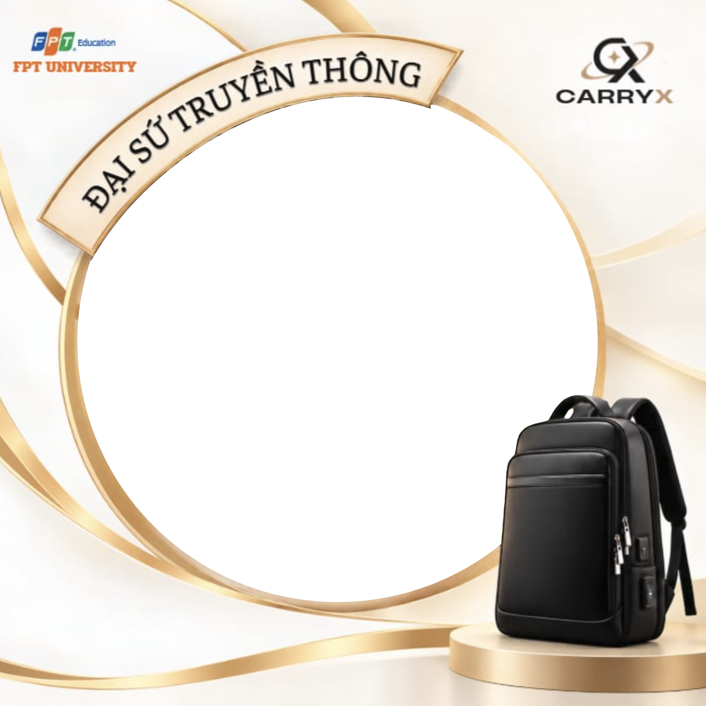

# CarryX Frame Studio · Khung Đại sứ truyền thông

Web tạo ảnh đại diện với khung **Đại sứ truyền thông CarryX**: chọn ảnh, kéo / phóng to / xoay để căn vào khung rồi tải về PNG.
Mọi xử lý diễn ra ngay trên trình duyệt, ảnh không bị gửi lên máy chủ nào.

## Tính năng

- Chọn ảnh từ máy, kéo-thả hoặc dán ảnh (Ctrl+V)
- Kéo để di chuyển; phóng to bằng thanh trượt, cuộn chuột hoặc chụm hai ngón
- Xoay 90°, lật ngang, đặt lại; phím mũi tên để căn chính xác
- Ảnh dọc tự căn để khuôn mặt nằm giữa vòng tròn
- Xuất PNG đúng kích thước khung (1354 × 1354 px)
- Mở trong trình duyệt của Facebook / Messenger / Zalo: hiện ảnh để nhấn giữ và lưu
- Gợi ý caption kèm hashtag, có nút sao chép
- Giao diện sáng / tối theo hệ thống, cùng phong cách với [landing page CarryX](https://carryx-landing.vercel.app/)

## Cấu trúc

| File | Vai trò |
| --- | --- |
| `index.html` | Toàn bộ trang (HTML + CSS + JS, khung nhúng sẵn dạng base64). Mở trực tiếp hoặc deploy là chạy. |
| `carryx-frame-overlay.png` | Khung PNG trong suốt 1354 × 1354, dùng cho Canva / thiết kế hoặc để thay khung. |

## Deploy

**Vercel**: vercel.com → *Add New* → *Project* → Import repo `carryx-frame-studio` → Framework Preset: *Other* → *Deploy*.

**GitHub Pages**: *Settings* → *Pages* → Source: *Deploy from a branch* → `main` / `(root)` → *Save*.
Trang sẽ chạy ở `https://subzerozzz.github.io/carryx-frame-studio/`.

## Thay khung

Khung đang nằm trong thẻ `` của `index.html`.

1. Chuẩn bị file khung mới: ảnh vuông PNG hoặc WebP, vùng ảnh hình tròn để trong suốt, cùng bố cục với khung hiện tại. Kích thước tùy ý (ví dụ 2000 × 2000 cho ảnh nét hơn).
2. Thêm file vào repo, ví dụ `frame.png`.
3. Sửa `src` của thẻ trên thành `src="frame.png"`.

Trang tự đọc kích thước khung mới và xuất ảnh đúng kích thước đó.
Nếu vòng tròn ở vị trí hoặc độ lớn khác, sửa `GEO` trong script: `cx`, `cy` là tâm, `r` là bán kính, tính theo tỉ lệ so với cạnh khung.

> Khi `src` trỏ tới file riêng, cần mở trang qua máy chủ web (Vercel, GitHub Pages, Live Server…) thì nút tải ảnh mới hoạt động. Mở bằng `file://`, trình duyệt sẽ chặn xuất ảnh.

## Ghi chú

- Khung được tách từ ảnh mẫu của nhóm: vùng tròn khoét trong suốt, ribbon "ĐẠI SỨ TRUYỀN THÔNG" và balo vẫn đè lên ảnh như bản gốc. Có file khung gốc độ phân giải cao thì thay theo hướng dẫn trên.
- Font chữ: Cormorant Garamond, Be Vietnam Pro, JetBrains Mono (Google Fonts).
